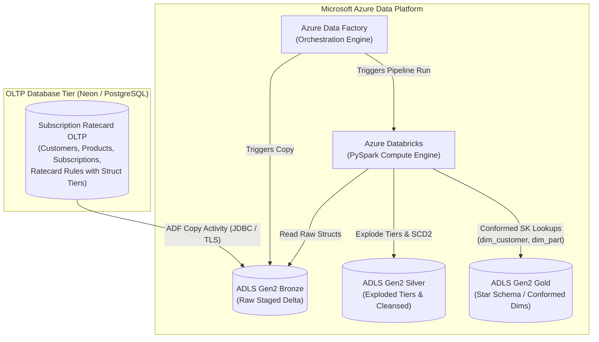

# Enterprise Ratecard Lakehouse Pipeline: OLTP -> ADF -> Databricks (Medallion Star Schema)

## 1. High-Level Architecture Overview

## 2. Key Engineering Challenges Solved

### A. High-Fidelity Struct Unnesting & Tier Explosion
* **Problem**: In OLTP, pricing tiers are stored as nested arrays of structs (`rate_tier_struct[]`). Directly querying nested arrays in analytical and BI tools (PowerBI, Tableau) degrades performance.
* **Solution**: The Silver layer extracts the rules header and explodes nested tier structs into discrete interval records with surrogate hashing (`SHA-256`), cleanly handling open-ended tiers (`max_usage = 999999999999`).

### B. Conformed Dimensional Modeling
* **Problem**: OLTP stores natural business keys (`customer_id`, `part_number`).
* **Solution**: The Gold transformation performs high-performance lookups against pre-existing enterprise conformed dimensions (`dim_customer`, `dim_part`) to assign integer surrogate keys (`customer_key`, `part_key`), mapping missing or late-arriving records to `-1 (UNKNOWN)`.

### C. Automated ADF Orchestration
* **ADF Pipelines**: Configured with parameterization (`watermark_timestamp`, `environment`), invoking Copy Activity to land raw Delta tables into Bronze ADLS Gen2, followed by triggering Databricks notebook execution for Silver/Gold curation.
